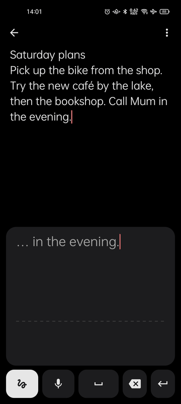
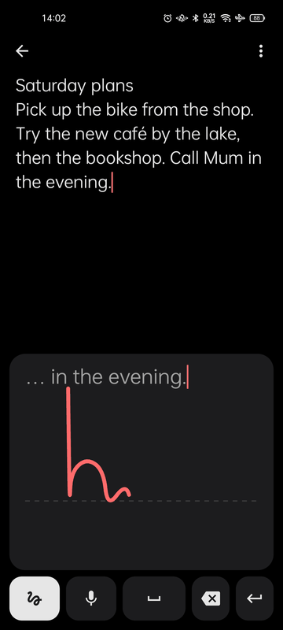
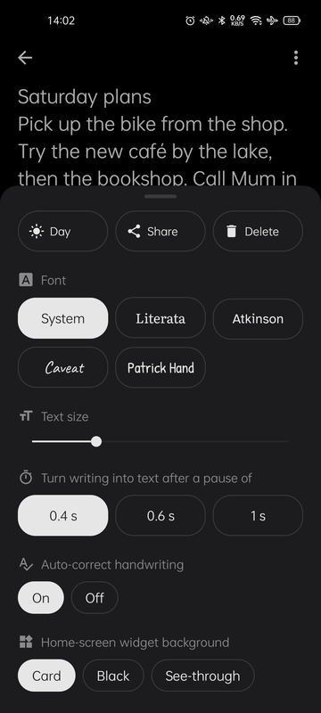
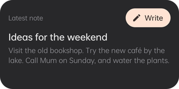

<p align="center">
  
</p>

<h1 align="center">Cute Notes</h1>

<p align="center">
  Notes you write with your finger, big, on a phone-sized pad.<br>
  Your handwriting turns into text as you go.
</p>

<p align="center">
  <a href="https://github.com/Vaib215/cute-apps/releases"></a>
  <a href="https://github.com/sponsors/Vaib215"></a>
</p>

<p align="center">
  
  
  
</p>

## Features

**Writing**
- A writing pad under your note (beside it, sideways). Write a word big; pause, and it becomes text at the cursor.
- See what's being read while you write. Start the next word back on the left and the last one turns into text straight away.
- The pad shows the line you're on: **draw a line through any word to delete it**, or through several.
- A row of other readings after each word: tap one to swap it in, or **Join** to glue a word written in two parts.
- **Auto-correct** from an English word list; put back what you wrote and it learns the word. Can be turned off.
- Hold to select text, then write to replace it; tap to move the cursor.

**Other ways in**
- **Voice:** tap the mic and talk; it keeps listening until you tap again.
- **Keyboard:** switch scribble off to type normally.

**Look**
- Night and day, five fonts (System, Literata, Atkinson Hyperlegible, and two handwriting fonts: Caveat and Patrick Hand), text size.
- How long a pause turns writing into text: 0.4, 0.6 or 1 second.

**Notes**
- Plain text, saved as you go, newest first. Share or delete from a note's options.
- A **Latest note** home-screen widget with a Write button (card, black or see-through), and a "New note" shortcut on the app icon.

<p>
  
</p>

## Privacy

Handwriting is read on the phone by Google's [ML Kit Digital Ink Recognition](https://developers.google.com/ml-kit/vision/digital-ink-recognition). Its English model (about 20 MB) is downloaded from Google once, which is why the app has internet permission; after that, writing works offline. ML Kit may send Google anonymous usage statistics under [its terms](https://developers.google.com/ml-kit/terms). Voice uses your phone's speech service (Speech Services by Google). Your notes never leave the phone.

## Install

Download `CuteNotes-<version>.apk` from [Releases](https://github.com/Vaib215/cute-apps/releases) and open it on your phone (Android 8.0 or newer). The first time you write, it fetches the handwriting model, so be online once.

## Build

Needs a JDK 17 and the Android SDK.

```sh
./gradlew assembleDebug      # app/build/outputs/apk/debug/CuteNotes-debug.apk
./gradlew assembleRelease    # signed with ~/.config/cute-apps/release.jks if present
```

## Credits

- Handwriting: Google ML Kit Digital Ink Recognition.
- Word list: [SCOWL](http://wordlist.aspell.net/) by Kevin Atkinson and others (see `app/src/main/assets/licenses/SCOWL.txt`).
- Fonts: [Literata](https://github.com/googlefonts/literata), [Atkinson Hyperlegible](https://www.brailleinstitute.org/freefont/), [Caveat](https://github.com/googlefonts/caveat) and [Patrick Hand](https://fonts.google.com/specimen/Patrick+Hand), under the SIL Open Font License 1.1 (see `app/src/main/assets/licenses`).
- Icons follow Material Design icon shapes (Apache 2.0).

## License

[MIT](../LICENSE)
