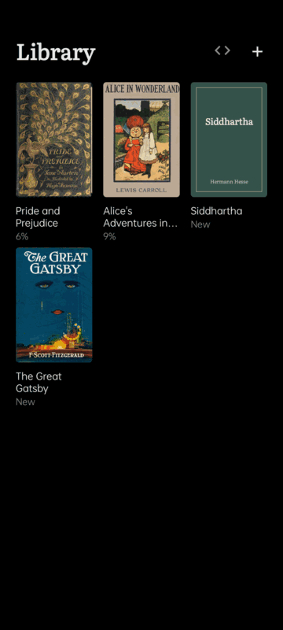
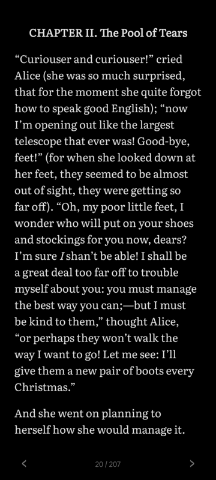
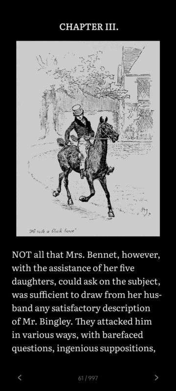
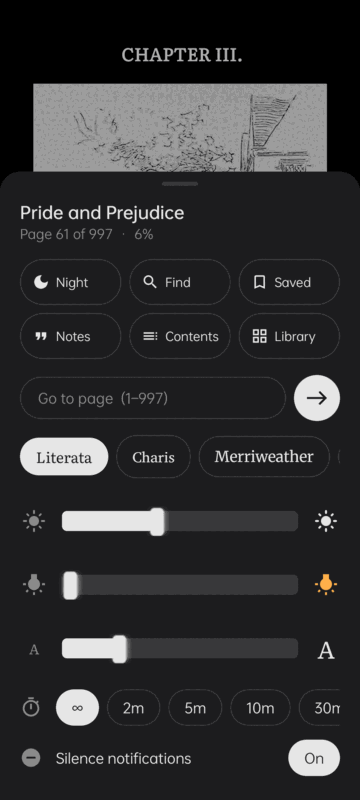
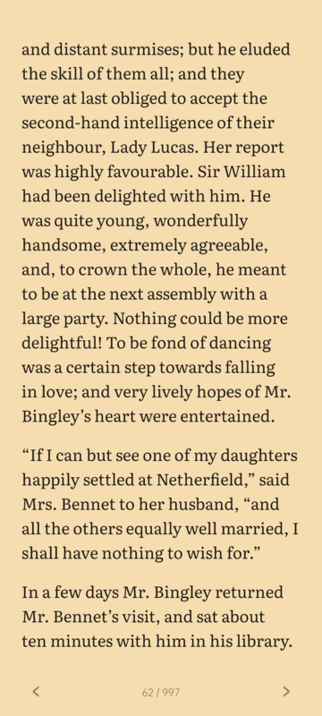
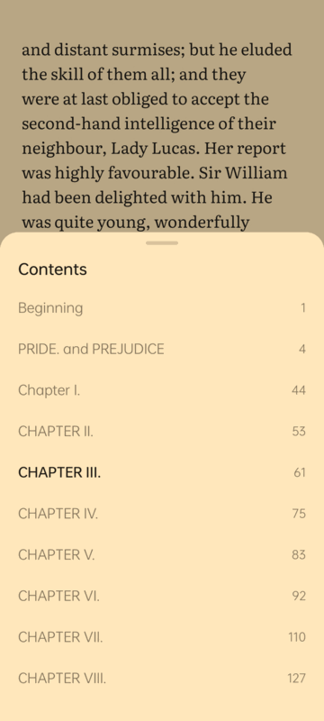
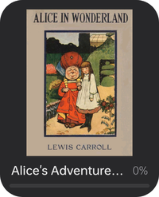
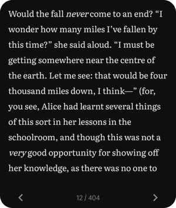

<p align="center">
  
</p>

<h1 align="center">Cute Reads</h1>

<p align="center">
  A calm, distraction-free e-book reader for Android.<br>
  Black page, white text, nothing else until you ask for it.
</p>

<p align="center">
  <a href="https://github.com/Vaib215/cute-apps/releases"></a>
  <a href="https://github.com/sponsors/Vaib215"></a>
</p>

<p align="center">
  
  
  
</p>
<p align="center">
  
  
  
</p>

## Features

**Reading**
- Full screen: no status bar, no clock, no notifications. Previous and next buttons at the bottom; the page number opens the options.
- Night and day modes, **warmth** (like Night Shift), brightness and text size.
- Five reading fonts: Literata, Charis, Merriweather, Atkinson Hyperlegible and the system font.
- Italics, bold, pictures and chapter breaks come through from the book.
- Portrait and landscape; on a wide screen the text keeps a comfortable line length.

**Finding your way**
- The book's own contents, with page numbers.
- Find in book (whole words and word starts) and go to page.
- Remembers your page in every book.

**Highlights, notes and bookmarks**
- Press and hold a word and drag to select; keep holding at the bottom edge to carry on to the next page.
- Add a note to any highlight. Highlights, notes and bookmarks are listed together with their pages.

**Your books**
- A library of covers, most recently read first, with progress. Books without a cover get a typeset one.
- Add EPUB and TXT books from your files, or with "Open with Cute Reads" from a file manager.
- DRM-protected books are recognised and explained (they can't be opened).

**Home-screen widgets**
- **Continue reading:** your book's cover, title and progress; tap to carry on.
- **Current page:** the page you're on, in your reading font and colours, with ‹ › to turn pages. Turning here moves your place, so the app opens where the widget is. The text fits whatever size you make it.
- Both resize freely, and can sit on a card, on black, or straight on the wallpaper (reading options › widgets).

<p>
  
  
</p>

**Quiet**
- Optional Do Not Disturb while a book is open; alarms still ring.
- Screen timer: keep the screen on for as long as you read, or let it sleep after 2–30 minutes.
- Works offline. No ads, no tracking, no accounts, no internet permission.

## What's new in 1.1

- Home-screen widgets: Continue reading and Current page.
- Reading fonts now ship as app resources (so widgets can use them).

## Install

Download `CuteReads-<version>.apk` from [Releases](https://github.com/Vaib215/cute-apps/releases) and open it on your phone (Android 8.0 or newer). Your phone may ask you to allow installing apps from your browser or file manager.

The app comes with no books. Free, DRM-free books are available from [Standard Ebooks](https://standardebooks.org) and [Project Gutenberg](https://www.gutenberg.org).

## Build

Needs only the Android SDK (build-tools and a platform) and a JDK. No Gradle.

```sh
./build.sh            # CuteReads.apk, debug-signed
./build.sh install    # ...and install over ADB
./build.sh release    # CuteReads-<version>.apk, signed with your release key
```

`release` reads the keystore from `~/.config/cute-apps/release.jks` and its password from `~/.config/cute-apps/release.pass` (override with `READ_KEYSTORE` / `READ_KEYSTORE_PASS_FILE`).

## Credits

- Fonts: [Literata](https://github.com/googlefonts/literata), [Charis SIL](https://software.sil.org/charis/), [Merriweather](https://github.com/EbenSorkin/Merriweather4) and [Atkinson Hyperlegible](https://www.brailleinstitute.org/freefont/), under the SIL Open Font License 1.1 (see `fonts/licenses`).
- Icons follow Material Design icon shapes (Apache 2.0).
- Screenshots show public-domain books.

## License

[MIT](../LICENSE)
