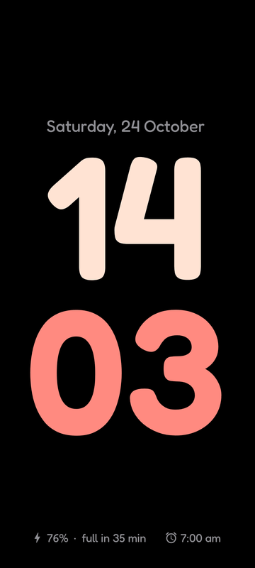
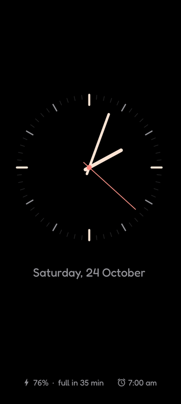
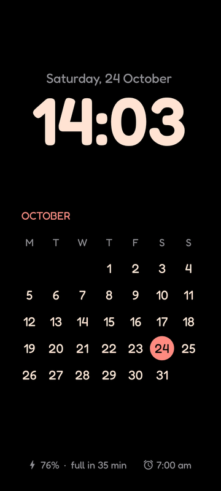
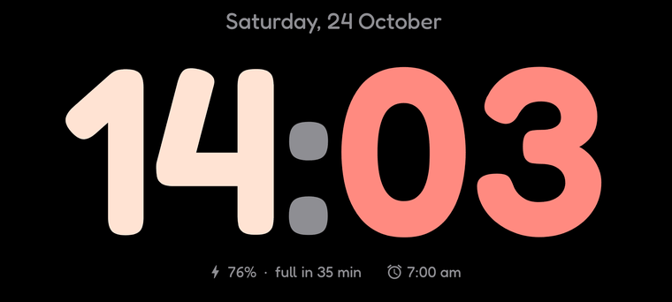
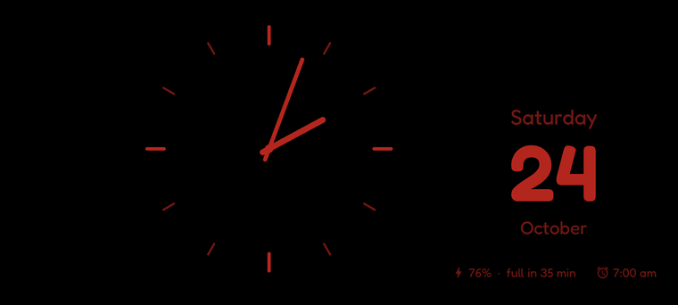
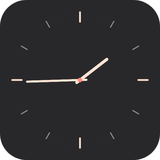

<p align="center">
  
</p>

<h1 align="center">Cute Sleep</h1>

<p align="center">
  A calm bedside clock for while your phone charges, like iPhone StandBy,<br>
  but upright or sideways, and it comes up by itself.
</p>

<p align="center">
  <a href="https://github.com/Vaib215/cute-apps/releases"></a>
  <a href="https://github.com/sponsors/Vaib215"></a>
</p>

<p align="center">
  
  
  
</p>
<p align="center">
  
</p>
<p align="center">
  
</p>

## Features

**The clock**
- Three faces, swiped between: a big clock, an analog clock, and the time with this month's calendar. Each lays itself out upright or sideways.
- Date, battery (a bolt while charging, and how long until full) and your next alarm.
- **Red at night:** in a dark room everything turns dim red and the screen goes right down.
- Moves a few pixels each minute, so nothing burns in. Tap to leave.

**Comes up by itself**
- Put the phone on the charger and lock it: the clock comes up over the lock screen. Unplug it and it goes away; turn the screen off while it's up and it stays off.
- Works on phones that hide Android's screen saver (it is also offered as one, for phones that allow it).
- Or one tap: the Sleep widget, "Sleep now" in the app, or the shortcut on the app icon.

**While charging**
- **Charge alert** at 80, 85, 90 or 100% (a battery kept below full lasts longer): a chime by day, a buzz at night.
- **Heat warning** if the battery passes 40 °C while charging.
- **Quiet at night:** Do Not Disturb while the clock is up in the dark (alarms still ring).
- Optionally, your **notifications** beside the clock, each with a cross to dismiss it.

**Widgets**
- Digital clock on one line, or hours over minutes; both grow to fill whatever size you give them.
- An analog clock drawn like the bedside one, and a one-tap Sleep button.
- On a card, on black, or straight on your wallpaper.

<p>
  
  
  
</p>

## Permissions

- Runs a quiet "ready" notification so it can notice the charger (Android requires one); turn "Automatically while charging" off and it goes.
- Notification access and Do Not Disturb access only if you switch those features on.
- No internet permission. Nothing leaves the phone.

## Install

Download `CuteSleep-<version>.apk` from [Releases](https://github.com/Vaib215/cute-apps/releases) and open it on your phone (Android 8.0 or newer). If the clock stops coming up by itself, let Cute Sleep run in the background in your phone's battery settings.

## Build

Needs a JDK 17 and the Android SDK.

```sh
./gradlew assembleDebug      # app/build/outputs/apk/debug/CuteSleep-debug.apk
./gradlew assembleRelease    # signed with ~/.config/cute-apps/release.jks if present
```

## Credits

- Font: [Fredoka](https://github.com/hafontia/Fredoka-One), under the SIL Open Font License 1.1 (see `app/src/main/assets/licenses`).
- Icons follow Material Design icon shapes (Apache 2.0).

## License

[MIT](../LICENSE)
