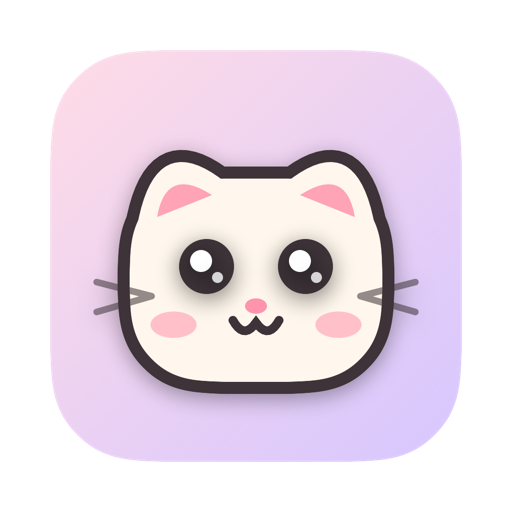
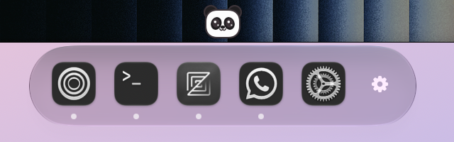
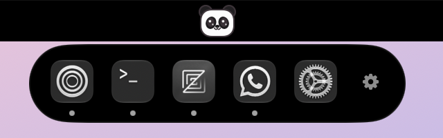
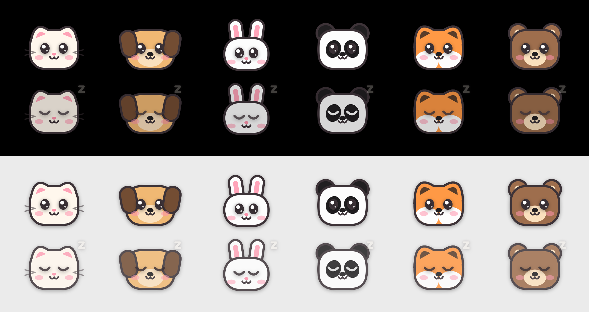
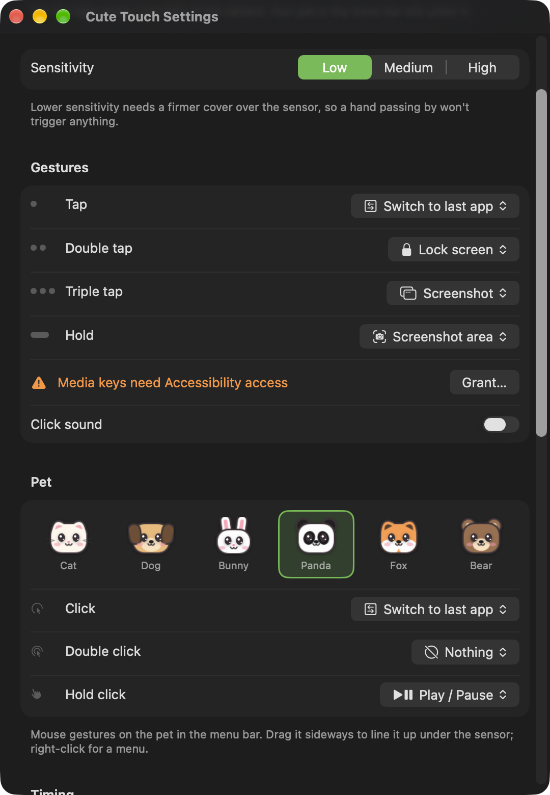

<p align="center">
  
</p>

<h1 align="center">Cute Touch</h1>

<p align="center">
  Tap the bezel of a MacBook that has no touchscreen.<br>
  A little pet in the menu bar shows you where.
</p>

<p align="center">
  
  <a href="https://github.com/sponsors/Vaib215"></a>
</p>

<p align="center">
  
</p>
<p align="center">
  
</p>

## How it works

A MacBook has an ambient light sensor in the bezel, just right of the camera, which macOS uses for
auto-brightness. Cute Touch reads it about ten times a second. When your fingertip covers it the light
drops, and the pattern of covers becomes a gesture. Nothing else is involved: no camera, no microphone.

## Features

**Gestures on the sensor**
- **Tap**, **double tap**, **triple tap** and **hold**, each set to whatever you like.
- Actions: open the panel, switch to the last app (a one-tap Cmd-Tab), play/pause, next/previous track,
  mute, lock screen, screenshot (full screen or an area, to the clipboard), open an app, run a Shortcut,
  or any shell command.
- **Sensitivity** Low / Medium / High, so a hand passing by doesn't count.
- **Dark rooms:** when there's no light to block, gestures pause and the sensor slows right down until
  the light comes back. Switching the lights off never counts as a hold.

**The pet**
- A cat, dog, bunny, panda, fox or bear sits in the menu bar right under the sensor, so you can find it.
  Drag it sideways to line it up.
- It blinks, its eyes go wide when your hand comes near, it hops when a gesture fires and it sleeps in
  the dark.
- **Click**, **double click** and **hold click** on it are gestures too.

<p align="center">
  
</p>

**The panel**
- Hangs under the pet: your pinned apps and recent apps, with a dot under the ones that are open.
- Hover the pet to peek at it; click to keep it open.
- Hover an open app for **live previews of its windows**, like the Windows taskbar. Click one to bring
  that window forward.
- **Dark** or native **Liquid Glass**.

**Settings**
- Every timing (double-tap window, hold length, hover delays, and so on) is a slider.
- Reset everything to defaults in one click.

<p align="center">
  
</p>

## Requirements

- A MacBook with an ambient light sensor. Built and tested on an M1 MacBook Air; other Apple
  Silicon MacBooks should work the same way.
- macOS 26 (Tahoe) or newer, and the Xcode 26 command line tools (Swift 6.2+) to build it.

## Permissions

- **Screen Recording:** only for window previews and the full-screen screenshot action.
- **Accessibility:** only for the media-key actions and for raising one specific window from a preview.
- No network access. Nothing leaves your Mac.

The pet and the panel are hidden from screenshots and screen sharing, so they never end up in your
captures.

## Build

```sh
./tools/make-signing-cert.sh   # once: a local signing identity, so permissions survive rebuilds
./build.sh                     # builds, installs to /Applications and starts at login
./build.sh app                 # only builds build/Cute Touch.app
```

Open **Cute Touch** from Launchpad or Spotlight to see the panel. Open Settings with the ⚙︎ in the panel,
by right-clicking the pet, or with `"/Applications/Cute Touch.app/Contents/MacOS/CuteTouch" --settings`.
To stop it starting at login, choose Quit, then delete `~/Library/LaunchAgents/com.vaib215.cutetouch.plist`.

The light sensor is read through a private part of IOKit (`IOHIDEventSystemClient`), the same way
apps like Lunar read it. It needs no entitlement, but Apple could change it in a future macOS.
